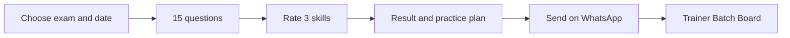
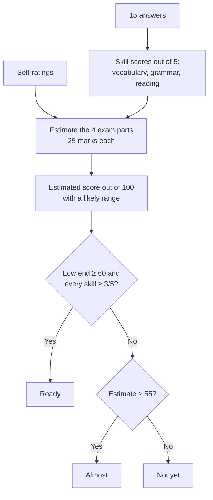
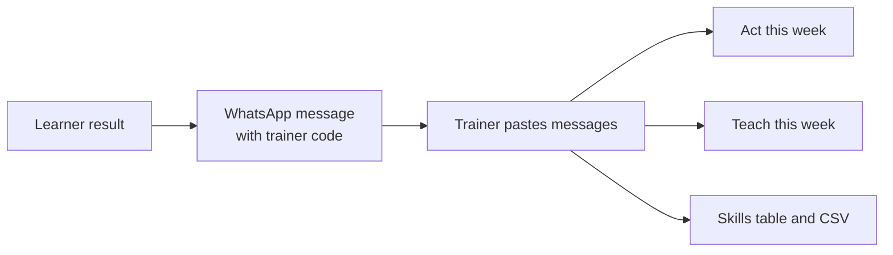
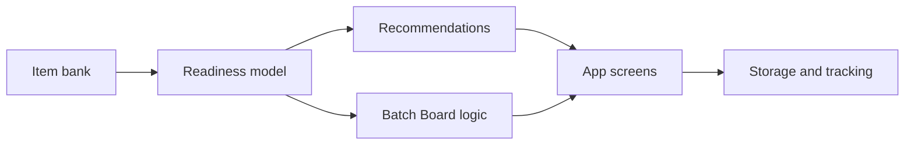

# Am I exam-ready?
 
A short check for learners who have finished A1 German and are about to book the **Goethe-Zertifikat A1** or **ÖSD Zertifikat A1** exam. It answers the learner's real question, *"Should I book my exam now?"*, and gives trainers a view of their whole batch.
 
**Why it matters:** in India exam fees are usually non-refundable and results take about 3 weeks, so one failed attempt costs money and more than a month.
 
| | Goethe A1 | ÖSD A1 |
|---|---|---|
| Parts | Listening, Reading, Writing, Speaking | Same four |
| Marks | 25 per part = 100 | Each part scored separately |
| Pass | 60 / 100, no minimum per part | 60% in **every** part |
 
---
 
## How it works
 

 
**Learner:** 15 exam-style questions (5 vocabulary, 5 grammar, 5 reading), an "I don't know yet" option instead of guessing, and a self-rating for listening, writing and speaking. The result shows:
- a verdict, with reasons
- an estimated score with a likely range
- the 2–3 things to practise
- a skill breakdown and an answer review
- advice based on the exam date
**Trainer (`#batch`):** paste the learners' WhatsApp messages and see who needs help this week, what to teach the batch, and a skills table with CSV export.
 
**Team (`#insights`):** a quality check on every question (% correct, "don't know" rate, whether it separates strong and weak learners) and JSON/CSV export.
 
---
 
## How evaluation works
 

 
1. **Fair test:** every attempt has 2 easy, 2 medium and 1 hard question per skill, drawn from a 45-question bank. A retake gets new questions, and the answer order is shuffled.
2. **Exam parts:** Reading → Lesen directly. Listening, writing and speaking are estimated from vocabulary, grammar and the self-rating. Self-ratings count for at most 30%, because beginners tend to overrate themselves.
3. **Likely range:** 15 questions can't be exact, so the app adds a statistical margin of error and shows "likely between X and Y".
4. **Strict on purpose:** a wrong "Ready" costs an exam fee, while a wrong "Almost" costs one more week of practice. For ÖSD, every exam part must also be at least 60%.
5. **Practice tips:** every question has a skill tag. A missed easy question counts more than a hard one (3 : 2 : 1), because it shows a basic gap.
*Example:* 12/15 → Ready · 10/15 → Almost · strong overall but 2/5 in reading → not Ready.
 
---
 
## Trainer Batch Board
 

 
- **Trainer code:** a short code carrying the name, batch, exam date and results. A built-in check flags codes damaged while copying, so they are never misread.
- **Act this week:** "Not yet" learners with an exam within 21 days come first, then "Almost" learners with an exam within 14 days, and so on. Each learner gets a specific action.
- **Teach this week:** the batch's 3 weakest areas, calculated as missed ÷ shown. Every learner sees different questions, so this is fairer than counting raw misses.
- **Private:** no login and no server. Everything is calculated in the trainer's browser.
---
 
## Architecture
 
Everything is in **one `index.html` file**: no framework, no build step, no backend. It runs on GitHub Pages or by double-clicking the file. The script has six marked sections:
 

 
- **Readiness model:** every rule is in one `CONFIG` object. For example, `minSkillForReady` sets how strict "Ready" is, `blueprint` sets the number of questions, and `partModel` sets the weights.
- **Storage:** the browser's localStorage only (attempts, the learner's name and batch, the trainer's last paste).
- **Tracking:** `track()` logs events. Setting `window.ANALYTICS_ENDPOINT` sends them to a backend.
**Run locally:** `python3 -m http.server 8000`, or just open `index.html`.
 
---
 
## Next steps
1. Collect real exam results and adjust the weights (target: 90% or more of "Ready" learners pass).
2. Audio listening questions.
3. AI feedback on writing.
4. A shared backend for the Batch Board.
 
