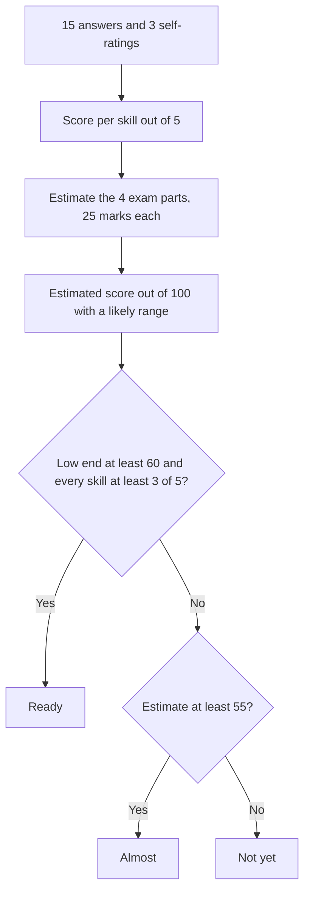

# Am I exam-ready?

A short check for learners who have finished A1 German and are about to book the **Goethe** or **ÖSD A1** exam. It answers the question *"Should I book my exam now?"*: an estimated exam score, readiness by skill, the 2–3 things to practise, and a **Trainer Batch Board** where trainers can see who needs help before their exam.

**Why it matters:** in India exam fees are usually non-refundable and results take about 3 weeks, so one failed attempt costs money and more than a month.

## How the result is decided

| Step | What happens |
|---|---|
| **Questions** | 15 questions: 5 vocabulary, 5 grammar, 5 reading. Each skill has 2 easy, 2 medium and 1 hard, drawn from a bank of 45. A retake gets new questions. "I don't know yet" stops lucky guesses. |
| **Exam parts** | Reading maps to the exam's reading part. Listening, writing and speaking are estimated from vocabulary, grammar and the self-rating (at most 30%). Each part is worth 25 marks, like the real exam. |
| **Likely range** | 15 questions can't be exact, so the app shows a margin of error ("likely between X and Y"). |
| **Verdict** | **Ready** only if even the low end clears the 60 pass mark and every skill is at least 3/5. For ÖSD, every part must also pass. It is strict because a wrong "Ready" costs an exam fee. |
| **Practice plan** | Missed questions point to small skills (e.g. numbers, word order). A missed easy question counts more than a hard one. |
| **Trainer Board** | The learner sends their result on WhatsApp. The trainer pastes the messages (`#batch`) and sees who to help this week, sorted by exam date, and what to teach the batch. |

## Tech

One `index.html` file: HTML, CSS and plain JavaScript, with no framework, no build step and no server. All the rules are in one `CONFIG` object in the code. Data stays in the browser. To run it, open the file or deploy with GitHub Pages.

## Next steps

- Collect real exam results to adjust the weights.
- Add audio listening questions.
- Add AI feedback on writing.
- Add a shared backend for the trainer board.
